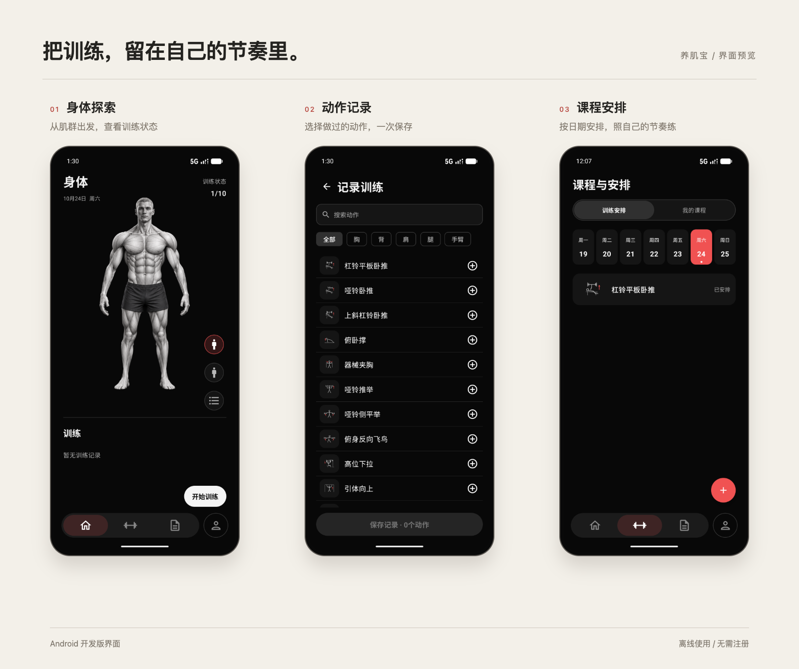

# 养肌宝

养肌宝是面向个人的 Android 训练记录应用。记录做过的动作、安排课程，回顾自己的训练历程。

- [下载 Android 安装包](https://github.com/cgl-sd/yangjibao/releases/download/v0.4.0/MuscleJournal-0.4.0.apk)

支持 Android 8.0 及以上。


## 功能

**身体探索**：直观感受训练的肌群，记录训练的变化。

**动作记录**：搜索、分类选择动作，支持增减与长按排序，一次保存本次记录；单侧动作可选择左侧或右侧。

**课程安排**：提供上肢力量、下肢力量和全身基础模板，支持调整动作与安排日期；当天安排自动预选，完成记录后同步安排状态。

**训练历史**：按日、周、月查看动作记录与图表。

**个人与成就**：保存身体资料，查看训练天数与达成的成就。

[](artwork/readme/screens.png)

> Android 开发版界面。

## 下载与安装

下载上方 Android 安装包，按系统提示安装。旧版可直接覆盖安装，也可在“个人 → 设置 → 检查更新”中获取新版。

## 资源

人体、头像与启动图标为本项目生成的插画素材。肌群介绍参考 [OpenStax Anatomy and Physiology 2e](https://openstax.org/details/books/anatomy-and-physiology-2e)；插画用于身体探索，不作为临床解剖图或实测肌肉激活数据。

## 开发

使用 Android Studio 打开项目，基于 Kotlin + Jetpack Compose 开发。

```bash
./src/scripts/build-debug.sh --offline
./gradlew :app:testDebugUnitTest :app:lintDebug :app:assembleDebugAndroidTest --offline
```

首次构建需安装 Android SDK 并获取依赖，再使用离线模式。

源码位于 `src/main/`，测试位于 `src/test/` 与 `src/androidTest/`，构建脚本位于 `src/scripts/`。
